> **Generated, not authoritative.** Player rulebook for design 0.13.0, written from the design draft and the 1871 rules. Copied from the Google Doc "The Two Crowns 1874 — Rules" of 2026-11-02 (design 0.4.0), with the changes from 0.5.0 to 0.13.0 patched in by hand. The file name carries the design version. Where it disagrees with `1874design.md`, the design draft wins. Regenerate it when the minor version changes.

THE TWO CROWNS 1874

**Rules, prototype version 0.13.0.** These are the rules of The Old Prince 1871 as implemented on Board Together ([justinkwaugh/tabletop, games/the-old-prince](https://github.com/justinkwaugh/tabletop/tree/main/games/the-old-prince)), changed for The Two Crowns 1874.

Text <mark>highlighted like this</mark> differs from 1871. Components that were only renamed are listed below and are not highlighted. The map, tile and component illustrations are not reproduced here.

# **CHANGES FROM 1871**

  - **Three starting companies.** Three Luka shares are drawn: the Mainline (leased by MÁV), the Shortline (leased by the Südbahn) and the new Public Line. Their president's certificates are sold in the auction with the MÁV, Südbahn and Narodna Concessions. The Mainline starts floated, the Shortline floats once one more share is bought, and the Public Line floats when its concession is sold. Every player holds a Public Line Bond that pays $10 per OR and may be exchanged for a Public Line share in any stock round.
  - **Trade-ins.** Once per OR, a company buying a train from the supply may hand in its train of the rank just below for half its face value (after 1894's train upgrade), so presidents can bring the rusts on sooner. A 4+ or a 7 can't be traded in.
  - **Hungarian Bank.** A second, smaller Austrian Bank that comes with a Public Line share. Until the first 2+ it may convert, during a stock round, into the Ganz Locomotive Works, handing its holdings to its owner.
  - **A bigger table.** 3–5 players, 10 company spaces including a Late space, 16 privates and one more train in most ranks.
  - **1894 track ideas.** Junction cities split in two in brown, and there are only three gray tiles.

|  |  |  |
| :-: | :-: | :-: |
| Rule | 1871 | 1874 (this document) |
| Players | 3–4 | 3–5 |
| Starting cash | $580 (3p), $480 (4p) | $840 (3p), $600 (4p), $480 (5p) |
| Certificate limit | 20 (3p), 16 (4p) | 25 (3p), 20 (4p), 16 (5p) |
| Auction deck | 15 items, 5 each (3p); 16 items, 4 each (4p) | 21 items, 7 each (3p); 20 items, 5 each (4p) or 4 each (5p) |
| Removed by player count | Ice Boat Shipping at 3 players | One of Zadar Station Rights, Virovitica Station Rights and the Rijeka Lazaretto (at random) at 4–5 players |
| Luka draw | Two shares: the Mainline and the Shortline | Three shares: the Mainline, the Shortline and the Public Line |
| Public Line | — | Starts at 86 with a reserved home, floats like the Shortline and receives $860. One share per player is reserved for the Public Line Bonds |
| Public Line Bond | — | One per player. Pays $10 per OR, can't be sold, and may be exchanged for its share in any stock round (forced on the first 4+). Until then its share is a reserved exchange share, like the Shortline's |
| Tranche chart | 8 companies: rows of 2 (Main, Short), 1, 2 and 3 | 10 companies: rows of 3 (Main, Short, Public), 2, 2 and 3 |
| Late space | — | Last space of the bottom row. A company there may start one price higher than the phase allows, and a Branch company may start there without a split |
| Branch companies | 6, started only by splitting | 5, started by splitting or in the Late space |
| Trade-ins | — | Once per OR, the rank just below the train bought, for half its face value; never a 4+ or a 7 |
| Companies buying privates | Hunslet only, from 4H | Wiener Neustadt, plus Zadar and Virovitica Station Rights for ½× to 1× face, from 4H until the first 4+; the Ancona Steamship for ½× to 1× face, to any company but the Luka, in the same window |
| Privates | 12 | 16\\. New: two Station Rights, the Rijeka Lazaretto (quarantine a rusting train), Narodna Concession, Hungarian Bank, Ancona Steamship |
| Map | Prince Edward Island; T city Charlottetown; Malpeque Shipyard | Croatia; Z (Zagreb) and R (Rijeka) cities, junction (J) and P cities, sea offboards, gray port towns and Rude Mines (a city without stations, like Malpeque Shipyard); mountains, the Sava and the Kupa cost $80, the Drava $60 |
| Junction cities | — | Six J cities split into two one-slot cities in brown |
| Gray tiles | X gray city; CX for Charlottetown | One CX (Karlovac) and two gray cities for any other brown city, one of them held by the Lika Survey Office. Only these may be laid in the final 3 ORs |
| Tile supply | Most yellow tiles unlimited | Every tile limited to the manifest (12.4) |
| Train counts (2H to D) | 4, 3, 3, 3, 2, 4, 3, 2, 4, 6 | 4, 4, 4, 4, 3, 4, 4, 3, 5, 10 (Diesels still unlimited) |
| Union Bank price | $120 | $140 (the Austrian Bank) |
| Concession prices | Mainline and Shortline $160 | MÁV $150, Südbahn $145 |
| End-game score | Union Bank goes to its owner | Austrian Bank and Hungarian Bank go to their owners |

### **RENAMED COMPONENTS**

|  |  |
| :-: | :-: |
| 1871 | 1874 |
| Prince Edward Island Railway (PEIR) | Luka (Pier) |
| PEIR companies (7) | Luka companies (8) |
| Union Bank | Austrian Bank |
| King's Mail | k.u.k. Post |
| Mainline / Shortline Concession | MÁV / Südbahn Concession |
| Merchants and Co. | Pazin Tunnel Company |
| Vernon River Bridge Company | Sava River Bridge |
| Shipbuilding | Kvarner Shipbuilding |
| Royal Agricultural Society | Slavonian Agricultural Society |
| Railcar Ferry | Kupa Steam Ferry |
| Hunslet Steam Engine | Wiener Neustadt Locomotive Works |
| Schreiber and Burpee Construction | Lika Survey Office |
| Charlottetown (CX) | Karlovac (CX) |

# **1 INTRODUCTION**

<mark>In 1874, the dual monarchs of Austria and Hungary reached Rijeka by rail. The Austrian Südbahn line from Pivka met Hungary's MÁV line from Karlovac, each determined to develop Croatia as they saw fit.</mark>

<mark>The Two Crowns 1874 runs on The Old Prince 1871's engine, with inspiration from 1894's finance and track developments. This game is not attempting to recreate the history of Croatia, but borrows its history and geography to explore a new narrative.</mark>

These rules assume familiarity with the 18xx system.

# **2 COMPONENTS**

  - 1 game map
  - 1 stock market
  - 1 set of game rules
  - Track tiles
  - <mark>16 private companies</mark>
  - Small charter for Austrian Bank
  - <mark>Small charter for the Hungarian Bank</mark>
  - <mark>5 Public Line Bonds</mark>
  - <mark>42 trains</mark>
  - <mark>2 sets of 5 player order cards numbered 1–5</mark>
  - Luka company components:

<!-- end list -->

  - 1 charter
  - <mark>8 Luka shares</mark>
  - <mark>6 Luka stations</mark>
  - 1 station marker for revenue

<!-- end list -->

  - <mark>13 10-share train companies: 8 Luka companies and 5 Branch companies:</mark>

<!-- end list -->

  - Charter
  - 9 share certificates (1 20%, 8 10%)
  - 4 station markers
  - 3 additional markers

<!-- end list -->

  - 1 round marker

|  |  |  |  |
| :-: | :-: | :-: | :-: |
| Type | Cost | \\\# | Rusts |
| 2H | $80 | 4 |  |
| 3H | $100 | <mark>4</mark> |  |
| 4H | $120 | <mark>4</mark> |  |
| 5H | $160 | <mark>4</mark> | 2H |
| 6H | $180 | <mark>3</mark> | 3H |
| 2+ | $220 | 4 | 4H |
| 3+ | $240 | <mark>4</mark> | 5H |
| 4+ | $200 | <mark>3</mark> | 6H |
| 7 | $500 | <mark>5</mark> | 2+ |
| D | $600 | <mark>10</mark> | 3+ / 4+ |

# **3 GAME SETUP**

  - Place the map and stock market in the center of the play area.
  - Use the revenue tracker if you prefer; it is provided only for convenience.
  - Place the round marker on the round tracker.
  - Organize the tiles, stocks, charters and stations as you wish. All shares start the game in the bank pool.
  - Organize the trains in ascending order, following the train chart, in a single stack.
  - The Bank is of unlimited size.
  - Consult the chart below for starting cash and certificate limit for each player count.

|  |  |  |  |
| :-: | :-: | :-: | :-: |
| <mark>Players</mark> | <mark>3</mark> | <mark>4</mark> | <mark>5</mark> |
| <mark>Bank</mark> | <mark>Unlimited</mark> | <mark>Unlimited</mark> | <mark>Unlimited</mark> |
| <mark>Starting cash</mark> | <mark>$840</mark> | <mark>$600</mark> | <mark>$480</mark> |
| <mark>Certificate limit</mark> | <mark>25</mark> | <mark>20</mark> | <mark>16</mark> |

  - Set aside the Luka charter.
  - <mark>Place $200 cash and the k.u.k. Post private company into the treasury of the Luka.</mark>
  - <mark>Randomly shuffle the eight Luka shares and select three at random.</mark> The associated Luka company on the first share selected is the Mainline for this game. The second share selected is the Shortline for this game. <mark>The third is the Public Line for this game. Each keeps its Luka company's name and home. Its station on the Main, Short or Public space of the tranche chart shows its role.</mark>
  - Place a Mainline stock market token on the stock market at the gray 92 space, and place a station on the Main space on the tranche chart. Also place a station at that company's home city on the map. Place $920 in the Mainline's treasury. The Mainline begins the game floated and does not require 60% to operate. Set aside the 20% presidency and three 10% shares. Place one 10% share in the treasury of the Austrian Bank. The rest are sold with private companies in the auction (MÁV Concession, Slavonian Agricultural Society and Kupa Steam Ferry).
  - Place a Shortline stock market token on the stock market at the gray 86 space, and place a station on the Short space on the tranche chart. Set aside the 20% presidency and three 10% shares. The 20% presidency will be sold in the auction and the three 10% shares are reserved as exchange shares for private companies Pazin Tunnel Company, Sava River Bridge and Kvarner Shipbuilding. The Shortline's home city is reserved for it; it places its home station there, free, when it floats.
  - <mark>Place a Public Line stock market token on the stock market at the gray 86 space, and place a station on the Public space on the tranche chart. Set aside the 20% presidency, which is sold in the auction with the Narodna Concession. Reserve one 10% share per player and deal each player a Public Line Bond for it. The Public Line's home city is reserved for it; it places its home station there, free, when it floats.</mark>
  - The three selected Luka shares are now removed from the game, leaving five remaining Luka shares that will be sold in the initial auction.
  - For each Luka share in the game, place a Luka station marker on its associated home city space as indicated on the share. These will be the five starting homes of the Luka for this game.
  - Select one Luka share at random from the five shares. Take one 10% share of the associated company and place it in the treasury of the Austrian Bank.
  - <mark>If playing with three players, shuffle the five Luka shares with all 16 private companies.</mark>
  - <mark>If playing with four or five players, remove one of Zadar Station Rights, Virovitica Station Rights and the Rijeka Lazaretto at random, and shuffle the five Luka shares with the remaining 15 private companies.</mark>
  - <mark>Place one Public Line share on the Hungarian Bank.</mark>
  - <mark>Deal the items face up, one at a time, clockwise around the table. First shuffle the MÁV Concession, Narodna Concession, Südbahn Concession, Austrian Bank and Hungarian Bank, and deal those five. Then shuffle the remaining privates with the five Luka shares and keep dealing from the next player until every player has the same number of items. With 5 players, each player should have 4 items. With 4 players, 5 items. With 3 players, 7 items. At 3 and 4 players some players get two of the first five.</mark> These items are public information.
  - Proceed to the initial auction.

# **4 GAME OVERVIEW**

  - The game begins with the initial auction. When the initial auction is complete, play continues with alternating stock rounds and operating rounds. This is tracked with the round marker.
  - <mark>During stock rounds players trade stock, start companies, and carve out positions for themselves with the railroads of Croatia.</mark>
  - After a stock round is completed, a number of operating rounds will be played based on the phase of the game when the stock round ended.
  - During the operating rounds, players see how their decisions play out. They build track, develop stations and purchase trains, all influencing the stock value of their investments.
  - The game ends with one complete set of operating rounds after the first Diesel train is purchased, or if a player goes bankrupt. The player with the largest net worth at the end of the game wins.
  - Player cash, holdings and companies are all public information and should be visible for the entire game.

# **5 INITIAL AUCTION**

## **5.1 INITIAL AUCTION TURN ORDER**

  - Randomly determine a start player. This player begins the game as the auctioneer. Turn order for the auction is always clockwise.

## **5.2 INITIAL AUCTION PROCEDURE**

1.  The auctioneer selects an item from the items dealt to them during setup to put up for auction. Only the two players to the left of the auctioneer participate in the auction of this item. If the auctioneer has only one item left, it is offered automatically.
2.  The player to the left of the auctioneer may now either pass or bid on the item. A bid must be at least $5 over face value and be a multiple of 5. Players may not bid more money than they have. If that player passes, play continues with the next player clockwise.
3.  The next player clockwise may now pass or bid, and the auction is resolved as follows:

<!-- end list -->

  - If both players bid, they continue bidding until one player passes. The player with the highest bid wins.
  - If the first player bids and the second player passes, the first player wins the auction.
  - If the first player passes and the second player bids, the first player may either pass again or elect to bid.
  - If both players pass, the next player clockwise is forced to purchase the item at face value. In a three-player game, this player is the auctioneer.

<!-- end list -->

1.  When a player is forced to purchase an item and can't afford it, the player with the most cash (ties broken by player order starting from the auctioneer) must buy it instead. <mark>If no player can afford it, all the privates in player hands pay their income (the k.u.k. Post, owned by the Luka, does not).</mark> The player with the most cash must now purchase the item. Continue paying income until a player is able to purchase the item. If no player-owned private earns income, nothing can be paid and the auction stalls.
2.  Once the item is sold, the player to the left of the auctioneer becomes the new auctioneer. All winning bids and forced purchases are paid to the bank. Repeat the steps above until every item is sold.
3.  After all items are sold, play continues to the first stock round. Player order, for the first stock round only, is determined by remaining player cash. From least cash to most, deal players a numbered player order card. The player with the least cash gets card \#1 and the player with the most gets the highest-numbered card. Ties are broken by previous turn order starting with the auctioneer.

# **6 STOCK ROUNDS**

## **6.1 STOCK ROUND TURN ORDER**

  - Turn order in stock rounds follows player order, beginning with the \#1 card and proceeding in ascending order.

## **6.2 STOCK ROUND OVERVIEW**

  - During a stock round, players may first **sell**, and then may do one of the following actions:

<!-- end list -->

  - Buy
  - <mark>Start a company (three ways)</mark>
  - Act on behalf of the Austrian Bank (only the owner of the Austrian Bank)
  - <mark>Act on behalf of the Hungarian Bank (only its owner)</mark>

<!-- end list -->

  - At any time on their stock turn, a player may use the private powers of Pazin Tunnel Company, Sava River Bridge and Kvarner Shipbuilding to exchange for a share, in addition to the actions above. Exchanging but performing no other stock action forfeits any previous order for priority. Exchanging with these privates allows the player to exceed the 60% ownership limit, and they are not required to sell down. <mark>Exchanging a Public Line Bond for its share and converting the Hungarian Bank (until the first 2+) are also done this way, in addition to the player's action.</mark>
  - If a player does none of these actions, they **pass** and receive the lowest-numbered available player order card for the next stock round from the unused set of player order cards.
  - A player that has passed may re-enter the stock round if play returns to them. If they take an action they forfeit their turn order card for the next stock round. The player with the next larger number card of the other color then swaps their card for the returned card, repeating as necessary for the other players so that the existing relative player order is maintained.

## **6.3 CERTIFICATE LIMIT**

  - There is a limit to the number of certificates a player may own. <mark>A certificate is one of the following: a 10% stock certificate, a 20% president's certificate, a private company, a Luka share, a Public Line Bond or a Bank charter.</mark>

|  |  |  |  |
| :-: | :-: | :-: | :-: |
| <mark>Players</mark> | <mark>3</mark> | <mark>4</mark> | <mark>5</mark> |
| <mark>Cert limit</mark> | <mark>25</mark> | <mark>20</mark> | <mark>16</mark> |

  - A player may not buy any certificate that would cause them to exceed the certificate limit. <mark>Luka, Public Line Bond and reserve share exchanges may cause a player to exceed the certificate limit temporarily.</mark>
  - If a player is over the certificate limit at the start of their turn in the stock round, they must sell down to at least the certificate limit if possible.

## **6.4 SELL ACTION**

  - A player may sell any number of shares on their turn under these conditions:

<!-- end list -->

  - They sell before they buy any shares, start a company, or act for the Austrian Bank.
  - The player does not sell the president's certificate. It may only be transferred between players and the Austrian Bank.
  - The company has operated. No shares of companies that have not operated may ever be sold.
  - The player may not sell more than 30% of one company in a single stock turn.
  - Shares of the Luka can't be sold and have no stock price.
  - <mark>Public Line Bonds can't be sold to players, companies or the bank.</mark>

<!-- end list -->

  - Shares are sold at current market value per share. The selling player receives the current market value per share in cash from the bank. If multiple shares of the same company are sold, they are collectively sold for the current market value.
  - The stock price of the sold shares moves vertically down one space. If the stock price reaches the bottom of a column it isn't moved any further. If shares were sold from multiple companies in a turn and would cause stock prices to move to the same space on the stock market, the selling player chooses the relative order of those stock prices and places them below any stock price markers already on that location.

## **6.5 BUY ACTION**

  - A player may buy 1 share on their turn, subject to these restrictions:

<!-- end list -->

  - They must have enough cash to pay for the share, and the share is available for purchase.
  - Buying the share doesn't cause them to exceed 60% ownership of a company (shares in the Austrian Bank or the Hungarian Bank don't count against its owner's limit).
  - Buying the share doesn't take the player over the certificate limit.
  - The player has not sold shares of that company earlier in the current stock round.

<!-- end list -->

  - Players may purchase stock only from the bank or from a company's treasury (not from the Austrian Bank). The price paid for all stock is the current value on the stock market. Stock bought from the bank is paid for to the bank; stock bought from a company treasury is paid for to that company's treasury.

## **6.6 EXCHANGE OF COMPANY PRESIDENCY**

  - Sell and buy actions may cause a change of ownership of a company's president's certificate. The player (or Austrian Bank) with the highest percentage of ownership of a company is its president and should own the president's certificate. If they don't, two 10% shares are exchanged with the owner of the president's certificate. Ties are broken in favor of the current owner of the president's certificate, then by player turn order. The Austrian Bank never has a player order and can't win ties for presidency based on turn order. <mark>The same applies to the Hungarian Bank. Public Line shares reserved for Public Line Bonds don't count toward its presidency until exchanged.</mark>

## **6.7 START A COMPANY**

  - <mark>There are two types of 10-share companies: Luka companies and Branch companies. The Luka companies are related to the Luka (see 7.7), and the Branch companies are only available to start when an existing 10-share company splits or in the Late space. There are three ways to start a company:</mark>

<!-- end list -->

1.  Start a Luka company
2.  Split an existing company
3.  <mark>Start a Branch company in the Late space (see 6.7.6)</mark>

<!-- end list -->

  - Both ways must follow the rules for company tranches and starting company market values.

## **6.7.1 COMPANY TRANCHES**

  - All companies started in the game are tracked on the tranche chart. The chart is read top to bottom and left to right. There are four tranches (rows) on the chart. <mark>The top tranche is reserved for the Mainline, Shortline and Public Line during setup.</mark>
  - A station is placed in those spaces to show that those companies have been started.
  - <mark>Tranche 1 has two spaces, tranche 2 has two spaces and tranche 3 has three spaces. The last space of tranche 3 is the Late space (see 6.7.6).</mark>
  - Companies may only be started if a space in a tranche is open and the tranche is available. A tranche becomes available if the tranche before it is full and every company in that tranche has either operated or is sold out.
  - Once every company in a tranche has operated or is sold out, the next tranche immediately becomes available and more companies may be started.
  - When every space on the chart is full, no more companies may be started. <mark>There are at most ten companies in the game.</mark>

## **6.7.2 STARTING COMPANY MARKET VALUES**

  - The prices available to start a company are the colored spaces in the second column of the stock market.
  - <mark>The 92 and 86 spaces are reserved for the Mainline and Shortline respectively, and the Public Line also starts at 86. No other companies may start at these prices, except in the Late space (see 6.7.6).</mark>
  - The remaining prices (80, 74, 65, 58) are available depending on the phase of the game.
  - Prices 80 to 58 are available from the beginning of the game. After the first 5H train is purchased the 80 price is no longer available. After the first 3+ train is purchased, only 65 and 58 remain. After the first 7 train is purchased, companies may only start at 58.

## **6.7.3 STARTING A LUKA COMPANY**

  - The first two steps define conditions that must be met.

<!-- end list -->

1.  Check that there is an available space in the current tranche on the tranche chart.
2.  Select an unstarted Luka company that has an associated Luka share owned by a player. This is shown by the Luka subheading below the company's name on the charter.
3.  Choose a starting market value and place the company's stock market token on that space. If there are other tokens in that space, the new token goes below them, at the bottom of the stack. Place one of the company's stations on an available space on the tranche chart.
4.  Purchase the company's 20% president's certificate for two times the starting market value.
5.  Place the company's charter and stations in front of the player who started the company.

<!-- end list -->

  - Nothing else happens until the company is floated.

## **6.7.4 SPLITTING A COMPANY**

  - The first two steps define conditions that must be met.

<!-- end list -->

1.  Check that there is an available space in the current tranche on the tranche chart.
2.  Select a company that the splitting player is currently the president of and which is floated (now called the *parent*). The splitting player must own at least four shares of the parent, and the parent must have at least two stations on the map. The splitting player must also be within the certificate limit and 60% ownership limits.
3.  Select an unstarted Branch company (now called the *child*). Place the child's charter and stations in front of the splitting player. Place one of the child's stations on an available space on the tranche chart.
4.  Select a starting market value available in the current phase and place the child's stock market token on that space. If there are other tokens in that space, the new token goes below them, at the bottom of the stack.
5.  Simultaneously, all players (and the Austrian Bank and the Hungarian Bank) exchange half of their parent shares (rounded down) for an equal number of shares of the child. The splitting player's exchange always includes two shares for the president's certificate of the child.
6.  Any parent shares exchanged are placed into the treasury of the parent.
7.  Half of the parent's shares owned by the bank (rounded down) are now placed in the company's treasury. The child's shares remain untouched in the bank.
8.  Shares of the parent reserved as exchange shares remain reserved and are not exchanged for shares of the child.
9.  After all shares are exchanged, the splitting player divides the assets of the parent.
10. First, exchange stations of the parent on the map for stations of the child. The parent may never give up its printed starting home location, but may give up any number of its other stations on the map. The child must receive at least one station as its home. Stations exchanged this way are lost and not returned to the parent.
11. <mark>The splitting player may now reallocate cash, trains and any private companies it owns between the parent and child in any way they prefer.</mark> After the allocation, neither company may be over the train limit.
12. Determine the starting capitalization of the child: count the child's shares remaining in the bank and multiply by the child's starting market value. Place that much cash from the bank in the child's treasury.

<!-- end list -->

  - Any parent company that splits and has previously operated is considered to still have operated after splitting.
  - The child company is not considered floated until 60% of the company is no longer owned by the bank. If 60% is already out of the bank after the exchange, it floats immediately.
  - A split is the player's one action for the turn.

<!-- end list -->

  - **Example.** Player A wishes to split a company they own 50% of (ZAG). Player B owns 30% and the bank pool holds the other 20%. <mark>There is a space available on the tranche chart and Player A selects Modrić (MB) as the child. The MB places its token on the stock market and tranche chart.</mark>
  - Everyone now splits their shares. <mark>Player A's 50% of ZAG becomes 30% of ZAG and 20% of MB (the president's certificate). The 2 shares of ZAG exchanged are placed in ZAG's treasury. Player B's 30% becomes 20% ZAG and 10% MB, with another 10% share of ZAG going into ZAG's treasury. The bank then splits its shares, turning 20% ZAG into 10% ZAG in the bank and 10% ZAG in the treasury: a total of 4 shares in ZAG's treasury.</mark>
  - <mark>Now Player A divides up ZAG's assets. ZAG must give MB at least 1 home station. Player A elects to give MB both of its non-home stations, all of its trains, and almost all of its cash. The ZAG tokens given up are removed from the game. Player A owns 20% of MB and Player B owns 10%. With seven 10% shares of MB in the bank, MB receives 7 times its starting stock price in cash. MB needs 3 more 10% shares bought to float.</mark> Play continues.

## **6.7.5 FLOATING A COMPANY**

  - When a company is started it does not operate until it is floated.
  - A Luka company is floated when at least 60% of its shares are no longer in the bank. When this condition is met, the company immediately receives ten times its starting market price in cash from the bank. The associated Luka station on the board is replaced with a station of the floated company. The associated Luka share is converted into a 10% share of the company from the bank pool. This may take a player over the 60% ownership limit; they are not required to sell down. The Luka station and Luka share are removed from the game. This may change the presidency of the Luka.
  - The Shortline floats the same way: once 60% of its shares are out of the bank, its three reserved exchange shares included, which means one more share must be bought after the concession is sold. It then receives $860 (10 × 86) and places its home station, free, on its reserved home city.
  - <mark>The Public Line floats the same way: once 60% of its shares are out of the bank, the shares reserved for Public Line Bonds and the Hungarian Bank's share included, so at every player count it floats when the Narodna Concession is sold.</mark> It then receives $860 (10 × 86) and places its home station, free, on its reserved home city.
  - A Branch company is floated when at least 60% of the company is no longer in the bank.

## **6.7.6 THE LATE SPACE**

  - <mark>The last space of tranche 3 is the Late space. Every other space is normal.</mark>
  - <mark>A company started in the Late space may be a Luka company, a Branch company from a split, or a Branch company started on its own, without a split.</mark>
  - <mark>It may start at any price available in the current phase, or one space higher than the phase's highest: 86 from 2H, 80 from 5H, 74 from 3+ and 65 from the 7.</mark>
  - <mark>A Luka company always starts at its printed home, in any space.</mark>
  - <mark>To start a Branch company on its own, follow steps 1, 3, 4 and 5 of 6.7.3. It floats at 60%, receives ten times its starting market price, and places its home station, free, on any city with an open station space that has no tile yet and isn't a reserved home. If every such city already has a tile, it may pick a tiled one; if no city qualifies, it can't be started.</mark>

## **6.8 ACTING FOR THE AUSTRIAN BANK**

  - Once per stock round, the owner of the Austrian Bank may perform a buy or start-a-company action on behalf of the Austrian Bank. The Austrian Bank must pay for as much of the action as possible and then the owner contributes the difference. The Austrian Bank follows all stock round rules for buying and starting a company as though it were another player. The Austrian Bank may never sell shares in a stock round.
  - <mark>The owner of the Hungarian Bank may act for it in the same way, once per stock round, as their one action.</mark>

## **6.9 ENDING A STOCK ROUND**

  - A stock round ends when all players pass. Players return this stock round's player order cards and should have a new player order card for the next stock round.
  - At the end of every stock round, any company that has no shares in the bank and none in a company treasury is sold out and moves up one space on the stock market. Adjust these in descending stock market value. <mark>Exchange shares (the Bonds' reserved shares included) and shares in the Austrian Bank count as sold.</mark> If the company is already at the top of the stock market, do nothing.

# **7 OPERATING ROUNDS**

## **7.1 OPERATING ROUND OVERVIEW**

  - Every operating round is part of a set of operating rounds played between stock rounds. The number of operating rounds in the set is set by the phase at the start of the set. It does not change if the phase changes during the set.
  - The train limit, rusting, tiles, offboard values and private company details always change immediately when the phase changes.
  - The president of a company makes all decisions for that company during an operating round.

## **7.1.1 OPERATING ROUND STRUCTURE**

  - <mark>At the beginning of each operating round in a set, all private companies pay their owner the income printed on them, and each Public Line Bond pays its holder $10.</mark> After private companies pay, all other floated companies operate in descending stock price order. Ties are broken by right-most position on the stock market grid, then top to bottom of a stack of tokens at a single stock market value.
  - On its turn in the operating round, a company performs these actions in order:

<!-- end list -->

1.  Lay / upgrade track
2.  Place a station
3.  Run trains
4.  Distribute earnings
5.  <mark>Purchase trains (trade-ins, see 7.6.5)</mark>

<!-- end list -->

  - At any time on a company's turn, starting in phase 4H, it may purchase the Wiener Neustadt Locomotive Works private company from its owning player and use its special power. The Luka may never buy the Wiener Neustadt Locomotive Works.
  - <mark>From the 4H phase until the first 4+, a company may also buy Zadar or Virovitica Station Rights from a player for ½× to 1× face value, and a company other than the Luka may buy the Ancona Steamship from a player for ½× to 1× face value. Both sides must agree.</mark>
  - The Luka always operates last.

## **7.2 LAYING TRACK**

  - On its turn, a company may lay or upgrade track (see section 12). A company may lay one yellow tile for free and optionally a second yellow tile for $20. The company may instead lay no yellow tiles and upgrade one tile, but it may not lay a yellow tile and upgrade a tile in the same turn.
  - If a hex has a printed terrain cost, the company pays it to the bank. The terrain cost is in addition to the $20 extra tile fee.
  - <mark>If a player owns the Lika Survey Office private company, that player has access to the second gray city tile, G2. From the Diesel, any company they preside may lay it as its upgrade, on any brown city but Karlovac.</mark> Placing it requires the same connectivity as any other tile.

## **7.3 PLACING A STATION**

  - A company may place a station once per operating round in an unreserved (see 7.3.1) city spot that the company is connected to. A station costs $80. A company must have an unused station available to place it. No company may have more than one station per hex. All companies begin with 4 stations.

## **7.3.1 RESERVED STATIONS**

  - The printed home stations on the map are reserved as starting locations for those companies. Typically, a Luka station occupies the space and converts into a station of the reserved company when it floats. Stations may not be built on a location if that would prevent the home of an unstarted company from being occupied.

## **7.3.2 BLOCKED CITIES**

  - A city is blocked if all its city spaces are filled with stations. Only trains belonging to companies with stations in a blocked city may pass through it.

## **7.4 RUN TRAINS**

  - If a company owns any trains, it must run them for revenue during this step, for maximum revenue. A company's revenue is the sum of the revenues of all its trains. See section 13 for train and route definitions.

## **7.5 DISTRIBUTE EARNINGS**

  - A company may either pay dividends or withhold. Only the Luka may also half-pay, and it has special earnings distribution (see 7.7).
  - If a company pays dividends, divide its earnings by ten and pay that amount to each shareholder for each share held. Shares in the bank and in a company's treasury pay to the treasury of the company. <mark>Reserved exchange shares, the Public Line shares reserved for Public Line Bonds included, pay nothing.</mark>
  - If a company withholds, place all its earnings in its treasury.

## **7.5.1 ADJUST STOCK PRICE**

  - If the company paid any dividend greater than $0, move its token one space right on the stock chart, or in the direction of the arrow if it is in the last space of a row. If the company paid no dividend, move its token one space left, or in the direction of the arrow if it is in the first space of a row. Companies that don't operate don't adjust their stock prices.

## **7.6 PURCHASE TRAINS**

  - A company may purchase one or more trains from the bank or from other companies during this step.
  - <mark>A train bought from the bank must be the currently available train, at its printed price, less any trade-in (see 7.6.5).</mark>
  - For a train bought from another company, both presidents must agree on the price. It must be at least $1 and no more than the cash in the purchasing company's treasury.
  - Trains are always purchased one at a time and must comply with the current train limit. A purchase may cause an immediate phase change and so a change in the train limit.
  - Trains are always purchased in roster order (see 13.2). All trains of a rank must be purchased before any of the next rank.

## **7.6.1 TRAIN LIMIT**

  - The train limit is set by the current phase. A company may never own more trains than the train limit, and may never buy a train over the limit, even if the purchase would trigger a phase change that rusts trains back under it. If a company owns more trains than the limit after a phase change, it immediately discards trains until it is at the limit. Discarded trains are removed from the game. Trains may never be discarded voluntarily.

## **7.6.2 TRAIN RUSTING**

  - When a rank of trains rusts, all trains of that rank are removed from the game (the 4+ always runs at least once; see 13.2). Rusting happens immediately on the phase change. <mark>A train carrying the Rijeka Lazaretto's quarantine marker runs for one more operating round first (see 11.3).</mark>

## **7.6.3 REQUIREMENT TO OWN A TRAIN**

  - Any company other than the Luka that has a valid route must own a train. A valid route is a station that connects to at least two revenue centers. A company with a valid route that reaches the end of its turn without a train must buy one. The Luka is never required to own a train.

## **7.6.4 FORCED TRAIN PURCHASING**

  - A company forced to purchase a train at the end of its turn must buy the next available train from the bank at its printed price.
  - First, the cash in the company's treasury is applied to the price. If that isn't enough, the company must first sell all of its own shares held in its treasury. This sale may exceed the 30% sell limit. The company receives the current market value for each share sold, and the stock price moves down one space for the sale.

<!-- end list -->

  - If the company still lacks the cash, the president must contribute the difference. If the Austrian Bank or the Hungarian Bank is the president, it pays first, selling its shares if needed, and then its owner pays. If the president doesn't have enough cash, they must sell shares, subject to these restrictions:

<!-- end list -->

  - May not sell more than 30% of a single company.
  - May not give up the presidency of the company that is force-buying.
  - May not sell any company that has not operated.
  - May not sell more shares than necessary to pay for the train.

<!-- end list -->

  - The president chooses which shares to sell and in what order. Adjust stock prices for each sale as in a stock round, following the sell rules (6.4). If the president still can't raise enough money, they are bankrupt and the game ends immediately.

## **7.6.5 TRADE-INS**

  - <mark>Once per operating round, when a company buys a train from the bank, it may hand in one of its trains of the rank just below the one it buys: a 5H for a 6H, a 6H for a 2+, a 3+ for a 4+. A 4+ and a 7 can never be traded in, so a 7 and a Diesel take no trade-in. Half the handed-in train's face value comes off the price, and that train leaves the game rather than going to the bank pool. Every company may trade in, the Luka included.</mark>
  - <mark>Trade-ins apply only to new trains from the bank, never to trains bought from the bank pool or another company. A company buying two trains in one step may trade in against only one of them.</mark>
  - <mark>The rank just below is never one the purchase rusts, so a trade-in always gives up a train that could still run. Only the Rijeka Lazaretto's quarantine marker saves a rusting train.</mark>
  - <mark>The handed-in train is gone before the new one arrives, so a company at its train limit can trade in to buy.</mark>
  - <mark>A company forced to buy a train may trade one in; the credit reduces what the president must pay.</mark>
  - <mark>A train bought with Wiener Neustadt or Ganz may include a trade-in.</mark>
  - <mark>A traded-in train is removed, not sold, so it has no effect on phases.</mark>
  - <mark>A train carrying the quarantine marker may be traded in; the marker leaves the game with it.</mark>

<!-- end list -->

  - **Example.** <mark>In the 5H phase the Shortline owns a 5H. It buys the first 6H and trades in the 5H: $80 off the $180 price, so the rush costs it only $100. Every 3H rusts at once.</mark>
  - **Example.** <mark>In the 3+ phase the limit is 3. A company with two 2+ trains and a 3+ trades in a 2+ to buy another 3+: $110 off the $240 price, and it never goes over the limit.</mark>
  - **Example.** <mark>In the 6H phase the Mainline owns a 4H, which the first 2+ will rust. In the Mainline's operating turn its president closes the Rijeka Lazaretto and puts the quarantine marker on the 4H. When the Shortline buys the first 2+, the 4H runs once more in the Mainline's next run step, then is discarded, giving the Mainline an OR to raise cash for a new train.</mark>

## **7.7 THE LUKA**

  - The Luka has no stock price and always operates last. It may build out of any of its stations on the map. It has no extra stations to place.
  - The Luka runs trains exactly like other companies.
  - The Luka may pay dividends, half-pay or withhold.
  - If the Luka pays dividends, divide the total earnings by the number of Luka shares in player hands. Each player receives that amount, rounded up, per share.
  - If the Luka half-pays, place half the earnings (rounded up) in its treasury. The other half is distributed equally among Luka shares in player hands (rounded up).
  - <mark>As Luka companies float, Luka shares are removed from the game and the dividend per share increases.</mark>
  - If the Luka withholds, place its earnings in its treasury.
  - The Luka may never buy more than one train from the bank in a single operating round. It has no restriction on buying trains from other train companies, which follows the normal rules.
  - The Luka is never required to own a train and can never be forced to buy one.
  - The Luka may never purchase the Wiener Neustadt Locomotive Works.
  - The president of the Luka is the player with the most Luka shares. This is frequently a tie; ties go to the player with the lowest-numbered share. <mark>The Luka shares are numbered 1 Split, 2 Zagorje, 3 Lika, 4 Posavina, 5 Podravina, 6 Istrian, 7 Slavonian and 8 Karlovac. Remember that Luka shares leave the game as Luka companies float.</mark>
  - <mark>The k.u.k. Post always stays in the Luka's treasury.</mark> It pays $80 per operating round to the Luka. It closes on the 4+.
  - When the last Luka company floats, the trains and cash remaining in the Luka are lost forever. <mark>The Luka closes, and the k.u.k. Post closes with it.</mark>

## **7.8 ENDING AN OPERATING ROUND**

  - Once every company has operated, proceed to a stock round if all operating rounds in the set are complete; otherwise play another operating round.

# **8 END OF GAME**

  - The game end can be triggered in two ways: bankruptcy, or the purchase of the first Diesel.

## **8.1 BANKRUPTCY**

  - If a player fails to raise enough money for a forced train purchase, they are bankrupt and the game ends. Calculate end-game scores.

## **8.2 DIESEL**

  - After the set of operating rounds in which the first Diesel was purchased completes, play one final stock round. The next set of three operating rounds is the final set of the game. <mark>In those three operating rounds, only the gray tiles may be laid.</mark> Calculate end-game scores.

## **8.3 END-GAME CALCULATION**

  - The player with the highest net worth (cash, share value and private company value) wins. Bankrupt players can win the game. Luka shares are worth $80 each at the end of the game. <mark>The net worth of the Austrian Bank and of the Hungarian Bank (stock plus cash) goes to its owner.</mark> Open private companies count at face value; closed ones count nothing.

# **9 MAP**

<mark>The map is a geographical representation of Croatia: a northern band from Istria to Slavonia, and Dalmatia running south past the Lika mountains to Split. From most Luka homes, the Gorski Kotar mountains stand between the racers and Rijeka.</mark>

### **PLAIN HEXES**

Some show a terrain cost. <mark>Mountains and the Sava and Kupa cost $80; the Drava costs $60. Where the Sava runs through Novska, Lipovljani and the river hex south-east of Novska, it costs $60. The rivers run between cities, so most routes cross them.</mark>

### **CITIES**

Empty, or with a printed company home location. <mark>Revenue is listed by phase (yellow / green / brown). Where brown shows two values, the brown tile is a choice: 2 slots at the higher value or 3 slots at the lower.</mark>

|  |  |  |
| :-: | :-: | :-: |
| <mark>Location</mark> | <mark>Kind</mark> | <mark>Revenue</mark> |
| <mark>Zagreb</mark> | <mark>Z city, no home</mark> | <mark>30 / 30 / 70 or 60</mark> |
| <mark>Rijeka</mark> | <mark>R city, port</mark> | <mark>30 / 30 / 60 or 50</mark> |
| <mark>Luka homes (8)</mark> | <mark>X city; Karlovac is CX, Pula is P; Gospić is printed yellow</mark> | <mark>20 / 30 / 60 or 50</mark> |
| <mark>Ogulin, Koprivnica, Novska, Vinkovci, Slavonski Brod, Šibenik</mark> | <mark>Junction (J)</mark> | <mark>20 / 20 / 40 + 40</mark> |
| <mark>Virovitica, Zadar, Senj, Knin</mark> | <mark>City</mark> | <mark>20 / 20 / 40</mark> |
| <mark>Pazin, Delnice, Otočac, Križevci, Lipovljani, Požega, Vrana, Sinj, Donja Dubrava</mark> | <mark>Town</mark> | <mark>10</mark> |
| <mark>10 double-town hexes</mark> | <mark>Two towns</mark> | <mark>10 + 10</mark> |
| <mark>Krk, Rab, Pag</mark> | <mark>Island towns</mark> | <mark>20 / 10 / 10</mark> |
| <mark>Rovinj, Makarska, Vukovar, Beli Manastir, Legrad, Korenica</mark> | <mark>Gray towns</mark> | <mark>10 (Legrad 20)</mark> |
| <mark>Vodice, Vrlika, Bosanski Brod</mark> | <mark>Gray port towns, dead ends</mark> | <mark>10</mark> |
| <mark>Rude Mines</mark> | <mark>Gray city, no stations</mark> | <mark>20 / 20 / 60</mark> |
| <mark>Ljubljana</mark> | <mark>Offboard</mark> | <mark>30 / 40 / 60</mark> |
| <mark>Budapest</mark> | <mark>Offboard</mark> | <mark>40 / 40 / 70</mark> |
| <mark>Trieste</mark> | <mark>Offboard</mark> | <mark>20 / 20 / 60</mark> |
| <mark>Belgrade</mark> | <mark>Offboard</mark> | <mark>30 / 30 / 50</mark> |
| <mark>Banja Luka</mark> | <mark>Offboard</mark> | <mark>30 / 30 / 60</mark> |
| <mark>Sarajevo</mark> | <mark>Offboard</mark> | <mark>20 / 20 / 60</mark> |
| <mark>Ancona</mark> | <mark>Sea offboard</mark> | <mark>30 / 30 / 70</mark> |
| <mark>Dubrovnik</mark> | <mark>Sea offboard</mark> | <mark>40 / 40 / 70</mark> |
| <mark>Malta</mark> | <mark>Sea offboard</mark> | <mark>20 / 40 / 60</mark> |

### **TOWNS**

Black dots when not connected to track, dashes when connected. The value of a city or town is the number in the white circle on the hex. <mark>Delnice and Otočac sit in mountain hexes. The gray port towns are dead ends: a route may end there but not run through.</mark>

### **OFFBOARD LOCATIONS**

Always red. Revenue depends on the phase. <mark>Ancona, Dubrovnik and Malta are sea offboards, open to every company like any other offboard.</mark>

### **GRAY HEXES**

<mark>Fixed track on the Istrian coast, the Kvarner islands, the Dalmatian spur past Split and the border runs to the offboards. Gray hexes are never upgraded.</mark>

<mark>Rude Mines counts as a city for routes, paying $20 until the brown phase and $60 from it, but no station may be placed there (its black token), so it never blocks a route.</mark>

# **10 STOCK MARKET**

## **10.1 STOCK MARKET OVERVIEW**

  - The stock market tracks the values of the companies in the game.

|  |  |  |  |  |  |  |  |  |  |  |  |  |  |  |
| :-: | :-: | :-: | :-: | :-: | :-: | :-: | :-: | :-: | :-: | :-: | :-: | :-: | :-: | :-: |
|  |  | 111 | 122 | 136 | 152 | 170 | 190 | 215 | 240 | 270 | 300 | 330 | 360 | <mark>400\\+40</mark> |
| 88 | 92 | 100 | 110 | 121 | 133 | 146 | 160 | 180 | 200 | 225 | 250 | 280 |  |  |
| 82 | 86 | 93 | 101 | 111 | 123 | 137 | 152 | 167 | 185 | 203 |  |  |  |  |
| 78 | 80 | 86 | 94 | 102 | 112 | 122 |  |  |  |  |  |  |  |  |
| 71 | 74 | 79 | 84 | 89 | 94 |  |  |  |  |  |  |  |  |  |
| 60 | 65 | 69 | 73 | 78 |  |  |  |  |  |  |  |  |  |  |
| 55 | 58 | 61 | 65 |  |  |  |  |  |  |  |  |  |  |  |

  - <mark>Start prices are shaded gray: 92 (Mainline), 86 (Shortline and Public Line), then 80, 74, 65 and 58 by phase. A company in the Late space may start one price higher (see 6.7.6).</mark>

## **10.2 THE $400 + 40 SPACE**

  - A company on the $400 space that pays a dividend pays each share $40 more on top of the dividend.
  - The printed arrows on the stock market show the direction a company moves. If a company would move right and there is no space, it moves up instead. If it would move left and there is no space, it moves down instead. Whenever a company moves into a new space, it is placed below the existing stock price markers there, preserving order.

## **10.3 TRANCHE CHART**

  - This chart tracks which companies have been started and whether any companies are available to start.

|  |  |  |
| :-: | :-: | :-: |
| Main | Short | <mark>Public</mark> |
| One | <mark>One</mark> |  |
| Two | Two |  |
| Three | Three | <mark>Late</mark> |

# **11 COMPANIES**

## **11.1 TRAIN COMPANY OVERVIEW**

  - Each company has a charter, nine share certificates (one 20% president's certificate and eight 10% shares), and seven station markers (four for the map, one for the stock market, one for the tranche chart and one for the optional revenue chart).

## **11.2 LUKA COMPANY COMPONENTS**

  - <mark>The Luka has eight special shares.</mark> Each share shows the Luka station, a number and an associated Luka company. <mark>The eight Luka companies are 1 Split (Split), 2 Zagorje (Varaždin), 3 Lika (Gospić), 4 Posavina (Sisak), 5 Podravina (Bjelovar), 6 Istrian (Pula), 7 Slavonian (Osijek) and 8 Karlovac (Karlovac). The five Branch companies are Kukoč (KB), Stojaković (SB), Modrić (MB), Petrović (PB) and Nikola (NB).</mark>
  - <mark>The Mainline, Shortline and Public Line keep their Luka company's name and home. Their president's certificates come with the MÁV, Südbahn and Narodna Concessions, which are private companies (11.3).</mark>

## **11.3 PRIVATE COMPANIES**

  - <mark>Each private company has a name, a private number in the top-right corner, a face value in the bottom-left, its revenue (dividend) in the bottom-right, and a brief description. All privates close on the first 4+, except the Austrian Bank, the Hungarian Bank, the Lika Survey Office and as noted on each card.</mark>

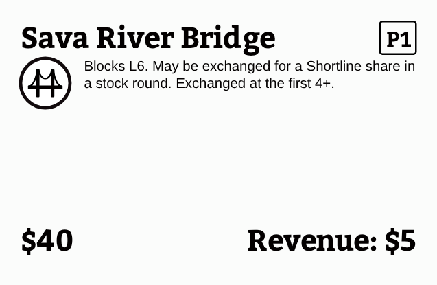

<mark>**Sava River Bridge** blocks the Sava hex L6, north-east of Zagreb, marked P1 on the map: no tile may be laid there until it closes.</mark> It may be exchanged for a reserved exchange share of the Shortline during the stock round. This action closes the company. It is in addition to any other sell or buy actions you take. Using this action by itself does not allow you to also pass. This company is forced closed on the 4+, and the owner receives the associated exchange share.

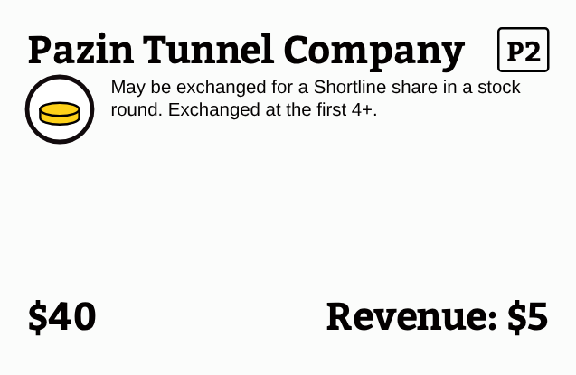

**Pazin Tunnel Company** may be exchanged for a reserved exchange share of the Shortline during the stock round. This action closes the company. It is in addition to any other sell or buy actions you take. Using this action by itself does not allow you to also pass. This company is forced closed on the 4+, and the owner receives the associated exchange share.

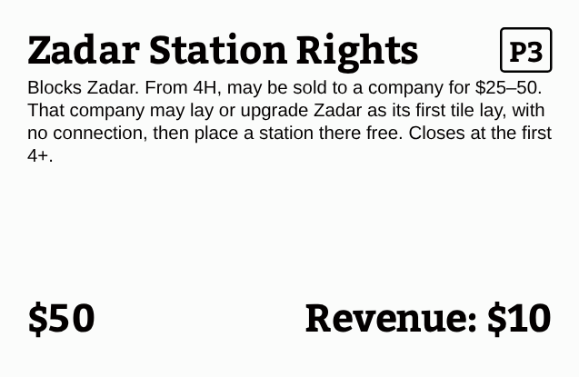

<mark>**Zadar Station Rights.** No tile may be laid on Zadar while a player owns this company. From the 4H phase until the first 4+, it may be sold to a company for ½× to 1× face value; both sides must agree. The owning company may lay or upgrade the Zadar tile without a connection; this counts as one of its tile lays, or its upgrade, that turn. If it does, it may also place its cheapest station there, free, which counts as its station for that operating round. It can't lay the Zadar tile and upgrade it in the same turn.</mark> Closes on the 4+.

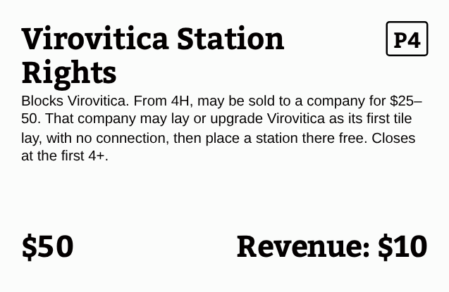

<mark>**Virovitica Station Rights** works as Zadar Station Rights, for Virovitica. Both are in play at 3 players; at 4–5 players one of the two or the Rijeka Lazaretto is removed at random.</mark>

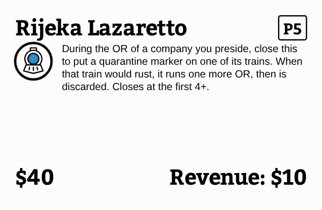

<mark>**Rijeka Lazaretto.** At any point in the operating turn of a company its owner presides, the owner may close the Lazaretto to put its quarantine marker on one of that company's trains. The marker stays on the train for the rest of the game. When that train would rust, it runs for one more operating round instead, in its company's next run step, and is then discarded; until then it counts against the train limit. An unused Lazaretto closes on the first 4+, but a marker already placed still saves a 6H from the 4+'s rust. A marked train may be traded in or sold; the marker goes with it.</mark>

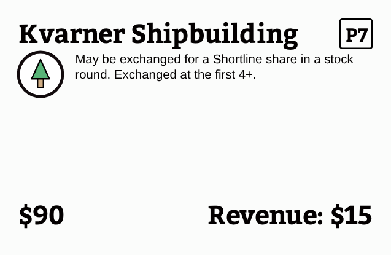

**Kvarner Shipbuilding** may be exchanged for a reserved exchange share of the Shortline during the stock round. This action closes the company. It is in addition to any other sell or buy actions you take. Using this action by itself does not allow you to also pass. This company is forced closed on the 4+, and the owner receives the associated exchange share.

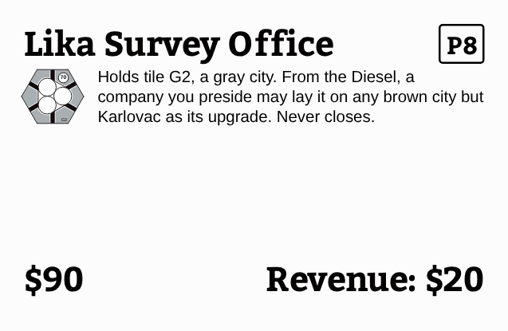

<mark>**Lika Survey Office** holds the second gray city tile, G2 ($70, 3 slots). From the Diesel, the owning player may allow any company they are president of to lay it, as that company's upgrade, on any brown city except Karlovac, labeled or junction included.</mark> Standard track laying restrictions and costs apply. <mark>It never closes and pays $20 every operating round for the whole game.</mark>

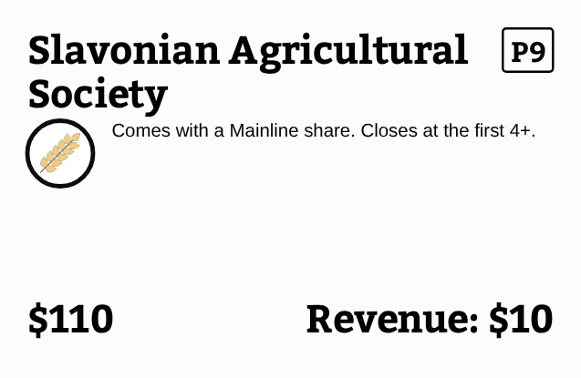

**Slavonian Agricultural Society.** Comes with a 10% share of the Mainline. Closes on the 4+.

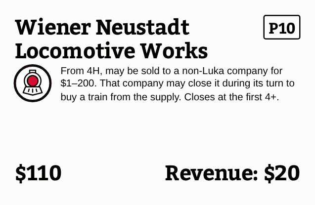

<mark>**Wiener Neustadt Locomotive Works** may be sold to a company, as may the Station Rights, the Ancona Steamship and Ganz.</mark> It may not be sold to the Luka. The purchasing company must pay at least $1 and at most $200. It may be sold from the 4H phase until the 4+. Wiener Neustadt gives the owning company the power to close it and purchase a train from the bank at any point in its operating turn. The company still pays for the train, but can buy it ahead of the Run Trains step. <mark>Wiener Neustadt closes on the 4+ if unused.</mark>

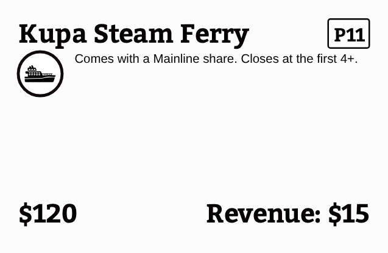

**Kupa Steam Ferry.** Comes with a 10% share of the Mainline. Closes on the 4+.

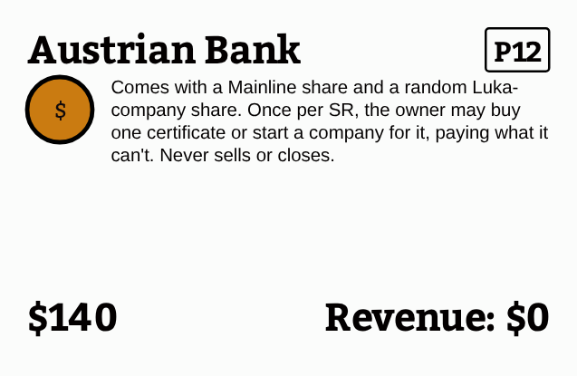

**Austrian Bank** begins the game with a 10% Mainline share and one other random 10% share of a Luka company. It does not close and counts as a single certificate. Once per stock round, its owner may purchase a single certificate for the Austrian Bank's treasury. The Austrian Bank pays for as much of the certificate as it can, and the owner contributes the difference. The Austrian Bank and its owner are two different entities. Shares owned by the Austrian Bank don't count against its owner's ownership limits. Dividends on its shares go to the Austrian Bank.

The Austrian Bank may never voluntarily sell shares, and its owner may never take assets out of it.

The Austrian Bank can be the president of a company. Its owner acts as the president of any company the Austrian Bank presides over. If required to force-buy a train, the Austrian Bank must first contribute as much as possible and sell shares if needed before its owner contributes.

At the end of the game, all cash and stock in the Austrian Bank is transferred to its owner for end-game calculations.

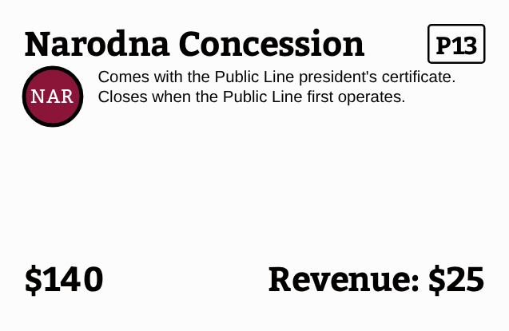

<mark>**Narodna Concession** comes with the 20% president's certificate of the Public Line. Closes when the Public Line operates for the first time. The Public Line floats as soon as this item is sold.</mark>

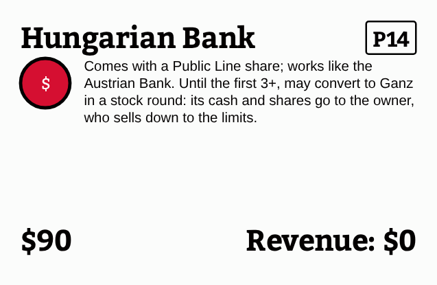

<mark>**Hungarian Bank.** It has no income. It starts with one 10% Public Line share and no cash, counts as one certificate and never closes unless converted. It works as the Austrian Bank: once per stock round its owner may buy one certificate or start a company for it, as their one action, the Hungarian Bank paying what it can and the owner the rest. It never sells voluntarily, its owner can't take assets out except by converting, dividends on its shares go into its treasury, its shares don't count against the owner's 60% limit, it can be a president, it exchanges shares in splits, and its cash and shares count for its owner at game end.</mark>

<mark>**Converting to Ganz.** Until the first 2+ is bought, the owner may convert the Hungarian Bank on any of their stock turns, in addition to their action. It can only convert during a stock round, never during an operating round. The Hungarian Bank's cash and shares go to the owner, presidencies included, and the Ganz Locomotive Works takes its place. The owner must then sell to the bank pool, at market price, any shares that take them over 60% of a company and enough shares to get back within the certificate limit. Normal sell rules apply, except the 30% limit, and these sales count as selling that company this stock round. The owner can't convert if they couldn't make those sales.</mark>

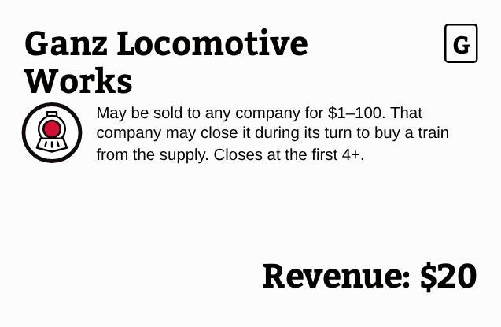

<mark>**Ganz Locomotive Works.** A private paying $20 per OR, which closes on the first 4+. It may be sold to any company for $1 to $100; both sides must agree. The owning company may close it at any point in its operating turn to buy one train from the bank at its printed price, less any trade-in. Using it closes it.</mark>

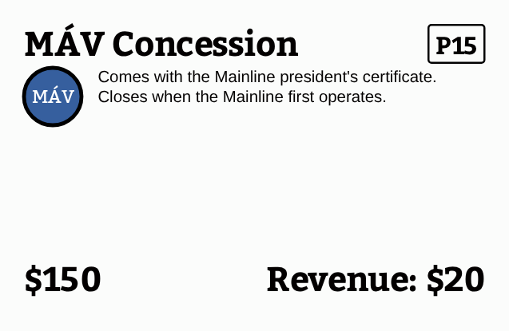

**MÁV Concession** comes with the 20% president's certificate of the Mainline. Closes when the Mainline operates for the first time. The Mainline begins the game floated and operating.

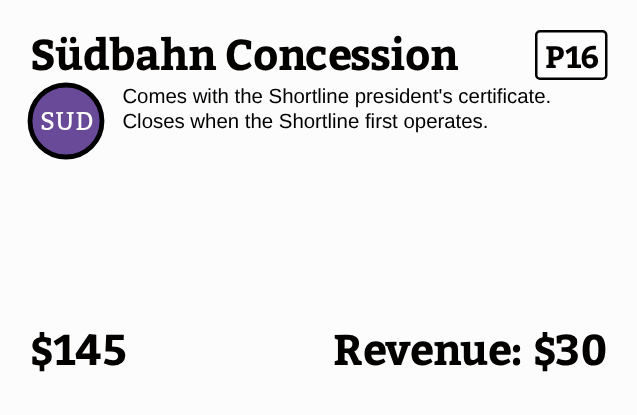

**Südbahn Concession** comes with the 20% president's certificate of the Shortline. Closes when the Shortline operates for the first time. The Shortline begins the game needing one more 10% share purchased to operate.

**All three concessions** also close on the first 4+ if their company has not operated by then.

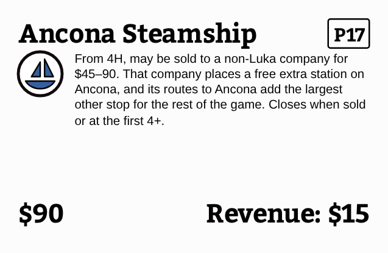

<mark>**Ancona Steamship** may be sold to any company other than the Luka, from the 4H phase until the first 4+, for ½× to 1× face value; both sides must agree. The buying company places its cheapest station on Ancona's station space, marked P17 on the map, free. It needs no connection for this, and it doesn't count as the company's station for that operating round. For the rest of the game, even after this private closes, that company's routes to Ancona add the revenue of the largest other stop on the route, town or offboard included. Closes when sold or on the first 4+.</mark>

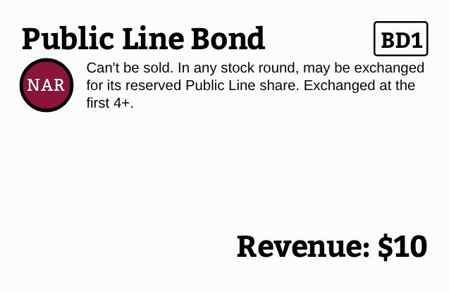

<mark>Not dealt in the auction: each player starts with one. It pays $10 every OR from the bank and counts as one certificate. It can't be sold to players, companies or the bank. In any stock round, from the first, its holder may exchange it for its reserved 10% Public Line share, in addition to their action. That share is then sold like any other, once the Public Line has operated. Until exchanged, the reserved share is an exchange share like the Shortline's: it counts toward the float and as sold for a sell-out, pays its dividends to no one, and doesn't count toward the presidency. Every remaining Bond is exchanged on the first 4+.</mark>

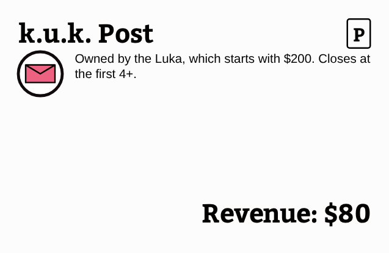

A private company belonging to the Luka. It begins the game in the Luka's treasury and pays $80 every OR. It closes on the 4+, or earlier if the Luka closes.

# **12 TRACK**

## **12.1 TRACK OVERVIEW**

  - Track is laid when a yellow tile is placed on the map in a plain hex.
  - Track is upgraded when a tile (including preprinted track on the map) is replaced with a tile of the next color. Plain hexes take yellow tiles. Yellow tiles are upgraded to green, green to brown, and brown to gray.
  - Some tile colors are only available in certain phases.
  - A tile placed on the map must preserve all track, cities, towns and stations.

## **12.2 TRACK LIMITATIONS**

  - When a company lays or upgrades a tile, it must add new track or increase the value of a city connected to one of the company's stations.
  - <mark>All tiles are piece-limited to the counts in the manifest below.</mark>
  - Track may not connect to the edge of the map or a gray hex without connecting track.
  - <mark>Track may not be placed on the Sava hex L6 until the Sava River Bridge is closed. No track may be placed on Zadar or Virovitica while a player owns its Station Rights.</mark>
  - No upgrades may be placed on gray or blue hexes.
  - The company must be able to trace a route to at least some of the new track on an upgraded tile.

### **BLUE AND GRAY PREPRINTED TRACK**

  - Not upgradeable, and track may not be laid into it that doesn't make a valid route.

## **12.3 TRACK TILES**

Track is placed on the map to create routes for trains. Yellow track is laid on plain hexes and can only be upgraded to green. Green may only be upgraded to brown, and only brown may be upgraded to gray.

### **X****, Z, R AND P** **CITIES**

<mark>Some cities are labeled X (the Luka homes), Z (Zagreb), R (Rijeka) or P (Pula) on the map. These upgrade to normal yellow cities but have special upgrades in green and brown.</mark> When upgrading an X tile, you may select any upgrade that preserves the route and follows the upgrade rules. The CX tile follows the normal X upgrade path for green and brown. <mark>There is a special gray CX tile reserved for Karlovac.</mark>

<mark>In brown, Z, R and X cities offer a choice: 2 slots at the higher value or 3 slots at the lower. Pula has only three open sides: in green it takes the one X tile that fits (X3), and in brown the three-sided P tile.</mark>

### **JUNCTION CITIES (J)**

<mark>Ogulin, Koprivnica, Novska, Vinkovci, Slavonski Brod and Šibenik are junctions. Their green-to-brown upgrade must keep track on every hex edge that had track, and the brown J tile is two one-slot cities, each on its own branch of two edges, $40 each. There are twelve brown J tiles: one for each way of pairing the edges, so every green junction has an upgrade, and a second J3, J7 and J9.</mark>

<mark>The green city has two slots, so up to two stations are set aside on the upgrade (1894's station update). If one is the upgrading company's, its president puts it on either city of the new tile at once. The rest go back at the end of the upgrading company's turn, in operating order: each owner picks either city, even one that already holds a station. Two stations on one city sit side by side, and the other city stays open. This is the only way two stations can share a slot, so a brown junction can hold three stations. A company can't have two stations on the tile. If two stations were set aside, the upgrading company can't place a station on the new tile that operating round. If both are other companies' stations, its trains may run through the hex that turn, since those stations only go back at the end of its turn. A route may visit both cities of a brown junction, as two separate stops, if track joins them. A brown junction can cut a rival's route in two.</mark>

### **GRAY TILES**

<mark>Cities stop at brown, except for three gray tiles available from the Diesel: the CX ($70, 3 slots), for Karlovac only, and two gray cities, G1 and G2 ($70, 3 slots), each for any one other brown city, labeled or junction included. Any company may lay G1; only a company the Lika Survey Office's owner presides may lay G2. On a junction a gray city joins the two halves back into one city, and every station on the tile moves into its three slots. In the final three operating rounds these are the only tiles that may be laid.</mark>

## **12.4 TILE MANIFEST**

|  |  |
| :-: | :-: |
| Color | Tiles and counts |
| Yellow | <mark>1 ×2, 3 ×8, 5 ×9, 6 ×9, 7 ×12, 8 ×25, 56 ×2, 58 ×6, 630, 631, 632, 633 ×2 each. Čakovec/Prelog takes only 56 or 632; Benkovac/Obrovac only 630 or 631</mark> |
| Green track and towns | <mark>16 ×4, 17 ×4, 21 ×2, 22 ×2, 25 ×5, 28 ×4, 29 ×4, 30 ×4, 31 ×4, 624 ×3, 625 ×2, 626 ×2; 143 ×2, 144 ×2</mark> |
| Green cities | <mark>C1 ×4, C2 ×5, C3 ×4 ($20, 2 slots); X1 ×2, X2 ×3, X3 ×2, X4 ×2 (X, $30, 2 slots); Z1, Z2, Z3 ×1 each (Z, $30, 2 slots); R1, R2, R3 ×1 each (R, $30, 2 slots)</mark> |
| Brown track and towns | <mark>39 ×2, 40 ×2, 41 ×1, 42 ×1, 43 ×1, 44 ×1, 45 ×1, 46 ×1, 47 ×1, 70 ×1, 627 ×1, 628 ×1, 629 ×1; 767 ×1, 769 ×1</mark> |
| Brown cities | <mark>611 ×3 ($40, 2 slots); X5 ×2, X6 ×3, X7 ×2 (X, $60, 2 slots); X8 ×2 (X, $50, 3 slots); P1 ×1 (P, $60, 2 slots); Z4 ×1 (Z, $70, 2 slots); Z5 ×1 (Z, $60, 3 slots); R4 ×1 (R, $50, 3 slots); R5 ×1 (R, $60, 2 slots); J1 to J9 ×1 each, with J3, J7 and J9 ×2 (J, two 1-slot cities, $40 each)</mark> |
| Gray cities | <mark>CX ×1 ($70, 3 slots, Karlovac only); G1 ×1 and G2 ×1 ($70, 3 slots, any one other brown city; G2 held by the Lika Survey Office)</mark> |

# **13 TRAINS**

## **13.1 TRAIN OVERVIEW**

  - Trains earn revenue by running a route of connected cities, towns and offboards and adding up the values the train reaches. Each train has a type, color, cost, and information about when it rusts or whether it is permanent.

## **13.2 TRAIN TYPES**

|  |  |  |  |  |
| :-: | :-: | :-: | :-: | :-: |
| <mark>Type</mark> | <mark>Cost</mark> | <mark>\\\#</mark> | <mark>Rusts</mark> | <mark>Upgrade</mark> |
| <mark>2H</mark> | <mark>$80</mark> | <mark>4</mark> |  | <mark>3H for $60</mark> |
| <mark>3H</mark> | <mark>$100</mark> | <mark>4</mark> |  | <mark>4H for $70</mark> |
| <mark>4H</mark> | <mark>$120</mark> | <mark>4</mark> |  | <mark>5H for $100</mark> |
| <mark>5H</mark> | <mark>$160</mark> | <mark>4</mark> | <mark>2H</mark> | <mark>6H for $100</mark> |
| <mark>6H</mark> | <mark>$180</mark> | <mark>3</mark> | <mark>3H</mark> | <mark>2+ for $130</mark> |
| <mark>2+</mark> | <mark>$220</mark> | <mark>4</mark> | <mark>4H</mark> | <mark>3+ for $130</mark> |
| <mark>3+</mark> | <mark>$240</mark> | <mark>4</mark> | <mark>5H</mark> | <mark>4+ for $80</mark> |
| <mark>4+</mark> | <mark>$200</mark> | <mark>3</mark> | <mark>6H</mark> | <mark>—</mark> |
| <mark>7</mark> | <mark>$500</mark> | <mark>5</mark> | <mark>2+</mark> | <mark>—</mark> |
| <mark>D</mark> | <mark>$600</mark> | <mark>10</mark> | <mark>3+ / 4+</mark> | <mark>—</mark> |

<mark>Upgrade is what a company pays for the next rank's train when it trades this train in (see 7.6.5): the new train's cost less half this train's. A 4+ and a 7 can't be traded in, and nothing trades in for a Diesel.</mark>

### **HEX TRAINS**

2H, 3H, 4H, 5H and 6H are hex trains. A hex train may pass through a number of hexes equal to its size; count the hex edges crossed. A 6H train may cross six hex edges, reaching seven hexes in total.

### **+ TRAINS**

2+, 3+ and 4+ trains may run to consecutive cities and offboards equal to their size, plus any number of towns between those points. The train may also collect trailing towns hanging off either end. A + train must include a city and at least one other revenue center for a valid route.

The 4+ train is guaranteed to run once. If the Diesel is purchased before a 4+ has run once, the 4+ runs in its company's next operating round and then rusts. 4+ trains can't be sold between companies after the Diesel has been purchased.

### **7 TRAINS**

Run to seven consecutive cities, offboards and towns.

### **DIESEL TRAINS**

No limit to the number of revenue centers counted, other than that the route must be consecutive and linear, following normal route restrictions. <mark>10 Diesel trains are included, but they are unlimited.</mark>

## **13.3 ROUTE**

  - A route is a continuous, unblocked length of track that:

<!-- end list -->

  - Includes at least one station of that company.
  - Doesn't reuse any track already used by another of that company's trains this turn.
  - Complies with the limits of the train type (H trains, + trains, 7 and Diesel).
  - Doesn't skip revenue centers.
  - Doesn't revisit a revenue center already visited by that train.
  - Doesn't pass through a blocked city. The train may stop there and count its revenue, but can't pass through.

A valid route must contain at least two revenue centers (cities, towns, offboards).

# **14 PHASES**

## **14.1 PHASE OVERVIEW**

  - As trains are purchased, the phase advances. The current phase always matches the most recently purchased train type. The phase sets the tiles available, the number of operating rounds, the train limit, available start prices, offboard values, train rusting and some private company details.
  - The game always begins in the 2H phase.

**2H**

  - 1 Operating Round per Set
  - Train Limit: 4
  - <mark>80 - 58 stock prices available (Late space: 86)</mark>
  - Yellow tiles available
  - Yellow offboard values

**3H**

  - 1 Operating Round per Set
  - Train Limit: 4
  - <mark>80 - 58 stock prices available (Late space: 86)</mark>
  - Yellow tiles available
  - Yellow offboard values

**4H**

  - 2 Operating Rounds per Set
  - Train Limit: 4
  - <mark>80 - 58 stock prices available (Late space: 86)</mark>
  - Yellow, green tiles available
  - Green offboard values
  - Wiener Neustadt Locomotive Works may be purchased by a company
  - <mark>Companies may buy Zadar and Virovitica Station Rights</mark>
  - <mark>Companies other than the Luka may buy the Ancona Steamship</mark>

**5H**

  - 2 Operating Rounds per Set
  - Train Limit: 4
  - <mark>74 - 58 stock prices available (Late space: 80)</mark>
  - Yellow, green tiles available
  - Green offboard values
  - 2H rusts

**6H**

  - 2 Operating Rounds per Set
  - Train Limit: 4
  - <mark>74 - 58 stock prices available (Late space: 80)</mark>
  - Yellow, green tiles available
  - Green offboard values
  - 3H rusts

**2+**

  - 2 Operating Rounds per Set
  - Train Limit: 3
  - <mark>74 - 58 stock prices available (Late space: 80)</mark>
  - Yellow, green tiles available
  - Green offboard values
  - 4H rusts
  - <mark>Hungarian Bank can no longer convert</mark>

**3+**

  - 2 Operating Rounds per Set
  - Train Limit: 3
  - <mark>65 - 58 stock prices available (Late space: 74)</mark>
  - Yellow, green tiles available
  - Green offboard values
  - 5H rusts

**4+**

  - 3 Operating Rounds per Set
  - Train Limit: 3
  - <mark>65 - 58 stock prices available (Late space: 74)</mark>
  - Yellow, green, brown tiles available
  - Brown offboard values
  - 6H rusts
  - <mark>Private companies close (except the Austrian Bank, the Hungarian Bank and the Lika Survey Office)</mark>
  - <mark>Remaining Public Line Bonds are exchanged</mark>
  - <mark>Junction cities may upgrade to brown</mark>

**7**

  - 3 Operating Rounds per Set
  - Train Limit: 2
  - <mark>58 stock price available (Late space: 65)</mark>
  - Yellow, green, brown tiles available
  - Brown offboard values
  - 2+ rusts

**Diesel**

  - 3 Operating Rounds per Set
  - Train Limit: 2
  - <mark>58 stock price available (Late space: 65)</mark>
  - <mark>Yellow, green, brown, gray tiles available (three gray tiles; only these in the final three ORs)</mark>
  - Brown offboard values
  - 3+ and 4+ rust (each 4+ runs once first)
  - Game ends at the completion of the next set (see 8.2)

# **15 CHEAT SHEET**

### **SETUP**

  - <mark>Random Main, Short and Public.</mark>
  - <mark>Random share for the Austrian Bank.</mark>
  - <mark>One of the Station Rights or the Rijeka Lazaretto fewer at 4–5 players.</mark>
  - <mark>Deal each player a Public Line Bond.</mark>
  - <mark>Deal the three concessions and the two banks first, shuffled; then shuffle and deal the rest with the 5 Luka shares.</mark>

### **INITIAL AUCTION**

  - The auctioneer selects an item to auction.
  - The two players to the left of the auctioneer may bid or pass. If both pass, the next player must buy. If they can't afford it, the player with the most cash must buy. If no player can afford it, all player-owned privates pay until a player can; the player with the most money buys.
  - After the item sells, the next player clockwise becomes the auctioneer.
  - Repeat until all items are sold.
  - Turn order for the first stock round is player cash, least to most. Ties are broken by previous turn order (auctioneer, then clockwise).

### **STOCK ROUNDS**

  - Sell, then buy.
  - Can't sell more than 30% of a company in a single turn.
  - Stock falls once per sale, not per share sold.
  - No limit to the bank pool. The presidency may never be in the bank pool.
  - <mark>The Austrian Bank and the Hungarian Bank may buy one certificate per stock round.</mark>
  - A tranche must be available to start a company. Tranches become available when all companies in the previous tranche have either operated or are sold out.
  - 60% required to float (except the Mainline).
  - Starting Luka train companies: the station goes on the map when floated. The associated Luka share converts into a 10% share after the company floats. 10 times the starting market price goes in the treasury.
  - Shortline: floats when one more share is bought after the concession; receives $860 and its free home station. <mark>The Public Line floats when its concession is sold.</mark>
  - Splitting a branch: the parent must have at least two stations on the map. The child gets at least 1 non-home station from the parent. Half the parent shares are exchanged for an equal number (rounded down) of child shares. The parent's president must be able to take the 20% presidency of the child. All parent shares exchanged go in the company treasury. Choose any available market price for the child. Divide the parent's trains, cash and private freely, keeping both within the train limit. The child receives current market value times the number of shares still in the bank pool. The child needs 60% out of the bank pool to float. The parent remains floated.
  - <mark>Shares in the Austrian Bank and exchange shares count for sell-outs.</mark>
  - <mark>Late space: start one price higher, or start a Branch company without a split.</mark>
  - <mark>Public Line Bonds can't be sold. Exchange for a share in any stock round, in addition to your action.</mark>

### **OPERATING ROUNDS**

  - 1 yellow or 1 upgrade. A 2nd yellow is $20.
  - All stations are $80.
  - A valid route is 2 revenue centers. Companies with a valid route must own a train.
  - Pay or withhold. The stock price moves forward one if the company pays, otherwise back one.
  - Emergency money raising: the company sells its treasury shares, then the president contributes. Can cause bankruptcy. Can't dump the company doing the EMR.
  - <mark>Trade-ins: once per OR, hand in the train of the rank just below the one bought, for half its face value. Never a 4+ or a 7.</mark>
  - <mark>Rijeka Lazaretto: close it in your company's OR to mark one of its trains; that train runs one more OR when it would rust.</mark>

### **LUKA**

  - Always operates last. May only buy 1 train from the supply per operating turn. <mark>May not buy Wiener Neustadt.</mark> May half-pay. Dividends are divided equally, rounded up. Luka shares may not be sold. <mark>Presidency goes by majority, ties broken by lowest-numbered share. k.u.k. Post pays $80.</mark>

### **GAME END**

  - Bankruptcy: the game ends immediately. Highest net worth wins.
  - Diesel: after the first Diesel is purchased, complete that set of ORs. <mark>Then complete one final stock round and three ORs, laying only gray tiles.</mark> Highest net worth wins.

### **PRIVATES**

  - Austrian Bank: acts exactly like another player. Its net worth goes to its owner at the end of the game. It can't voluntarily sell shares. It can be president of a company. It must spend all its cash before its owner pays for it. All normal player rules apply to it.
  - <mark>Hungarian Bank: as the Austrian Bank, but starts with one Public Line share. Until the first 2+ it may convert into Ganz during a stock round, a one-use train purchase.</mark>
  - <mark>Ancona Steamship: sell to a non-Luka company from 4H until the first 4+, for ½× to 1× face. The buyer gets a free Ancona station and bonus.</mark>
  - Exchange shares: an action in addition to sell/buy in the stock round. You lose your pass if you only exchange in a turn.
  - <mark>All privates close on the 4+ (except the Austrian Bank).</mark>
